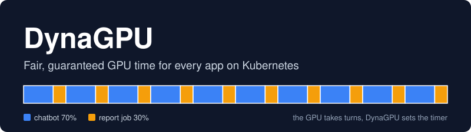
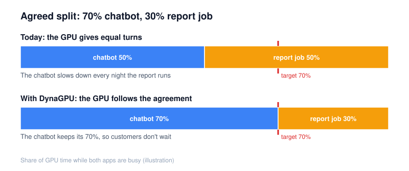
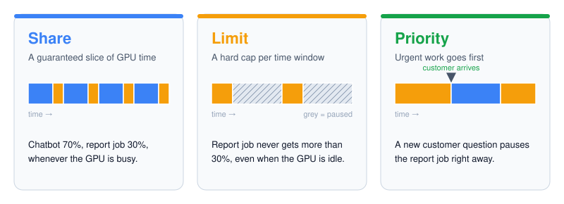
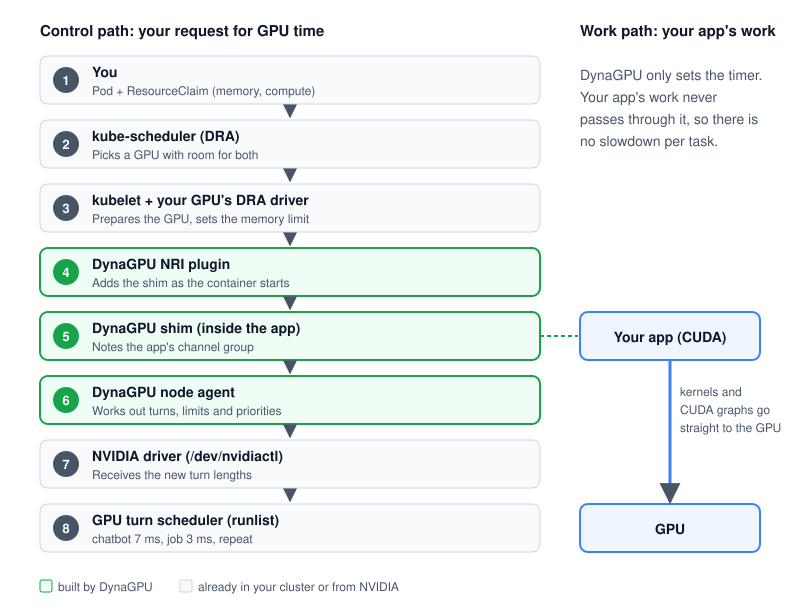
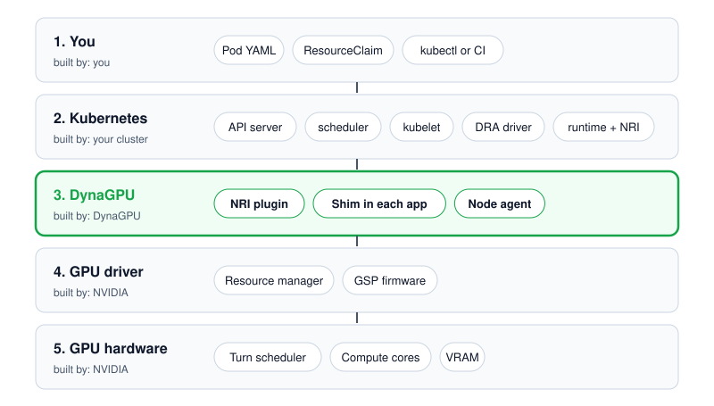

<p align="center">
  
</p>

# DynaGPU

**Fair, guaranteed GPU time for every app that shares a GPU on Kubernetes.**

DynaGPU lets several apps share one NVIDIA GPU and makes sure each one gets the share of GPU time it was promised. You can give an app a guaranteed share, put a hard limit on another, and let urgent work go first. If one app crashes, the others keep running.

> **Status: early design.** The first feasibility tests passed on real hardware: on an NVIDIA L40S, timeslice lengths gave 70/30 and 90/10 splits within 0.4 points of target, shares held with CUDA graphs and 33 ms kernels, and 10,000 pause cycles left results identical. If the agent dies, paused apps resume by themselves in about 1 second, and the driver controls are the same from driver 535 to 620 ([week 1](spike/results/week1.md), [week 2](spike/results/week2.md), [week 3](spike/results/week3.md)). Nothing here is ready for production yet, and names and settings may change.

## Contents

- [The idea in one minute](#the-idea-in-one-minute)
- [The problem: a real-life example](#the-problem-a-real-life-example)
- [How DynaGPU fixes it](#how-dynagpu-fixes-it)
- [What you get](#what-you-get)
- [How it works: from your request to the GPU](#how-it-works-from-your-request-to-the-gpu)
- [Architecture and layers](#architecture-and-layers)
- [Example: setting it up](#example-setting-it-up)
- [How the turn math works](#how-the-turn-math-works)
- [Safety first](#safety-first)
- [What DynaGPU does not do](#what-dynagpu-does-not-do)
- [Honest trade-offs](#honest-trade-offs)
- [Requirements](#requirements)
- [Roadmap](#roadmap)
- [Glossary](#glossary)
- [FAQ](#faq)

## The idea in one minute

Think of a GPU as a very fast kitchen with **one chef**.

When two apps share the GPU, the chef cooks for one app for a moment, then switches to the other, back and forth hundreds of times a second. Right now, **every app gets an equal turn**, no matter what you agreed.

DynaGPU gives you a timer for each app:

- **Share:** the chatbot gets 7 minutes of every 10, the report job gets 3.
- **Limit:** the report job never gets more than 3, even if the kitchen is empty.
- **Priority:** when a chatbot customer walks in, the chef pauses the report job straight away.

The chef keeps each app's ingredients separate, so if one app's dish burns, the other app's dish is fine.

## The problem: a real-life example

An online store runs two apps on its Kubernetes cluster:

- A **customer-support chatbot**. Real people are waiting for its answers, so it must stay fast.
- A **nightly report job** that crunches the day's orders. Nobody is waiting on it.

GPUs are expensive, so the team runs both apps on **one GPU** and agrees on a split: **70% for the chatbot, 30% for the report job.**

Here's what actually happens every night when the report job starts:

<p align="center">
  
</p>

- The GPU splits its time **roughly 50/50**, not 70/30.
- The chatbot gets **slower exactly when the report runs**, and customers wait longer for answers.
- The usual "fix" is to **buy a second GPU** that sits mostly idle. That's expensive and wasteful.

### Why the agreed split doesn't hold today

Today's GPU-sharing tools try to control the GPU **from the outside**, by slowing down an app's "work orders" (kernel launches) before they reach the GPU. That breaks in four ways:

1. **Bundled work slips through.** Modern AI apps send work in big bundles (CUDA graphs): one order that holds hundreds of tasks. A counter that counts orders sees one order and lets the whole bundle through.
2. **Work can't be called back.** Once a task is running on the GPU, nothing outside can pull it back, so long tasks run past any limit.
3. **It's only a guess.** The counter has to guess how much GPU time each order will take before it runs.
4. **It slows every app down.** Checking every single order adds a small delay to all of them.

The GPU's own built-in sharing only offers equal turns, so it can't do 70/30 or limits. The other common option runs apps side by side in one shared workspace (NVIDIA MPS). That can split the GPU by percentage, but **if one app crashes, it can take the others down with it.**

## How DynaGPU fixes it

**The GPU already takes turns. DynaGPU just sets the timer.**

Inside every NVIDIA GPU there is a small scheduler that rotates between apps and can pause an app in the middle of a task. NVIDIA's driver has built-in controls to:

- change how long one app's turn lasts,
- take an app out of the rotation and put it back,
- pause an app right now.

DynaGPU uses those controls for each app, based on what you asked for. Because **the GPU measures the time itself**, it doesn't matter whether an app sends one task, one very long task, or a bundle of hundreds. Nothing sits in the path of the app's work, so there's no slowdown on each launch.

<p align="center">
  
</p>

## What you get

- **Guaranteed share:** each app gets its agreed slice of GPU time whenever the GPU is busy.
- **Hard limit:** an app can be capped, even when the GPU has spare time.
- **Priority:** urgent apps jump the queue; other apps pause for a moment.
- **No wasted time:** when one app is idle, the others can use the whole GPU (unless they're capped).
- **Works with modern AI apps:** shares hold for bundled work (CUDA graphs) and long tasks.
- **No slowdown per task:** DynaGPU never touches your app's actual work.
- **Crash isolation:** each app keeps its own private GPU context, so one crash doesn't take down the rest.
- **No app changes:** you don't rebuild or modify your containers.
- **Kubernetes-native:** you ask for GPU time the same way you ask for any GPU in Kubernetes, with a claim.

## How it works: from your request to the GPU

There are two separate paths:

- **The control path** carries your request for GPU time down to the GPU's scheduler. This is where DynaGPU works.
- **The work path** is your app's real work. It goes **straight to the GPU**, and DynaGPU never touches it.

<p align="center">
  
</p>

| Step | What happens, in plain words | The technical piece |
| --- | --- | --- |
| 1 | You describe your app and ask for GPU memory and GPU time | A pod and a `ResourceClaim` with `memory` and `compute` capacity |
| 2 | Kubernetes picks a GPU that has room for both | kube-scheduler, using Dynamic Resource Allocation (DRA) |
| 3 | The GPU is prepared for your app and its memory limit is set | kubelet and your GPU's DRA driver plugin |
| 4 | DynaGPU adds a tiny helper to your app as it starts | DynaGPU's NRI plugin injects the shim library |
| 5 | When your app starts using the GPU, the helper notes its GPU "queue" | The shim records the app's channel group and registers with the node agent |
| 6 | DynaGPU works out everyone's turns, limits and priorities | The DynaGPU node agent |
| 7 | DynaGPU tells the GPU driver the new turn lengths | Driver control calls through `/dev/nvidiactl` |
| 8 | The GPU takes turns: chatbot about 11.7 ms, job 5 ms, repeat (a 70/30 split) | The GPU's own turn scheduler (runlist) |

**While your apps are running,** DynaGPU keeps working in the background:

- It recalculates turns whenever an app starts or stops.
- It measures each app's GPU time and pauses an app that hits its limit until the next time window.
- When a high-priority app wakes up, it pauses lower-priority apps right away.
- It renews a safety lease for every app. If DynaGPU stops, paused apps resume on their own.
- It publishes metrics, so you can see who got how much GPU time.

## Architecture and layers

DynaGPU adds **one thin layer** to your cluster. Everything else already exists.

<p align="center">
  
</p>

| Layer | What's in it | Built by |
| --- | --- | --- |
| 1. You | Your app's YAML (a pod and a GPU claim), sent with kubectl or a CI pipeline | You |
| 2. Kubernetes | API server, scheduler, kubelet, your GPU's DRA driver plugin, container runtime with NRI | Already in your cluster |
| 3. DynaGPU | NRI plugin, helper (shim) inside each app, node agent on each GPU server | **DynaGPU** |
| 4. GPU driver | NVIDIA driver: resource manager and GSP firmware | NVIDIA |
| 5. GPU hardware | Turn scheduler, compute cores, memory (VRAM) | NVIDIA |

### DynaGPU's components

| Component | What it does, in plain words |
| --- | --- |
| **NRI plugin** | Adds the helper to each GPU app as its container starts, and tags it with its pod and claim |
| **Helper (shim)** | A tiny library inside each app. It notes the app's GPU queue when the app starts using the GPU, and tells the node agent |
| **Node agent** | One per GPU server: the brain of DynaGPU |
| Node agent: claim watcher | Reads how much GPU time each app was given |
| Node agent: pod mapper | Matches each app to its GPU and its processes |
| Node agent: turn planner | Works out turn lengths, limits and priorities |
| Node agent: enforcer | Sends the turn settings to the GPU driver |
| Node agent: safety lease | Makes sure a paused app always resumes, even if DynaGPU stops |
| Node agent: metrics | Publishes GPU time, paused time, preemptions and waiting time per app |
| **Installer and CLI** | A Helm chart to install everything, and a command-line tool to see live turns and shares |

## Example: setting it up

> The API below is a draft and may change before the first release.

**1. Ask for GPU memory and GPU time.** Each app gets a claim. `compute` is the share of GPU time, out of 100.

```yaml
apiVersion: resource.k8s.io/v1
kind: ResourceClaimTemplate
metadata:
  name: chatbot-gpu
spec:
  spec:
    devices:
      requests:
        - name: gpu
          exactly:
            deviceClassName: gpu.example.com   # comes from your GPU's DRA driver
            capacity:
              requests:
                memory: 50Gi    # GPU memory for the chatbot
                compute: "70"   # 70% of GPU time when the GPU is busy
---
apiVersion: resource.k8s.io/v1
kind: ResourceClaimTemplate
metadata:
  name: report-gpu
spec:
  spec:
    devices:
      requests:
        - name: gpu
          exactly:
            deviceClassName: gpu.example.com
            capacity:
              requests:
                memory: 30Gi
                compute: "30"
```

**2. Run the apps.** A limit and a priority are set with simple labels on each app.

```yaml
apiVersion: v1
kind: Pod
metadata:
  name: support-chatbot
  annotations:
    dynagpu.io/priority: "high"            # customers are waiting: go first
spec:
  resourceClaims:
    - name: gpu
      resourceClaimTemplateName: chatbot-gpu
  containers:
    - name: server
      image: registry.example.com/support-chatbot:1.0
      resources:
        claims:
          - name: gpu
---
apiVersion: batch/v1
kind: Job
metadata:
  name: nightly-report
spec:
  template:
    metadata:
      annotations:
        dynagpu.io/compute-limit: "30"     # never more than 30% of GPU time
        dynagpu.io/priority: "low"         # step aside for urgent work
    spec:
      restartPolicy: Never
      resourceClaims:
        - name: gpu
          resourceClaimTemplateName: report-gpu
      containers:
        - name: report
          image: registry.example.com/nightly-report:1.0
          resources:
            claims:
              - name: gpu
```

**3. What happens next**, on a GPU with 80 GB of memory:

| Check | Math | Result |
| --- | --- | --- |
| Does the memory fit? | 50 GB + 30 GB = 80 GB | Yes, both apps go on the same GPU |
| Does the GPU time fit? | 70% + 30% = 100% | Yes, every promise can be kept |
| Turn lengths | 70% and 30%, with the 5 ms minimum turn | Chatbot about 11.7 ms, report job 5 ms, repeat |
| Report job limit | 30% of each 100 ms window | At most 30 ms of GPU time per 100 ms, even at 3 AM when the chatbot is quiet |
| Priority | Chatbot is `high`, report job is `low` | A new customer question pauses the report job straight away |

**4. What you'll see.** DynaGPU publishes metrics per app (names may change):

| Metric | Meaning |
| --- | --- |
| `dynagpu_gpu_time_seconds_total` | GPU time the app actually got |
| `dynagpu_throttled_seconds_total` | Time the app was paused for hitting its limit |
| `dynagpu_preemptions_total` | How often the app stepped aside for higher-priority work |
| `dynagpu_wait_seconds_total` | Time the app had work ready but was waiting for its turn |

## How the turn math works

When every app on a GPU is busy, each app's turn is its share of a short cycle:

```
turn length = cycle length × (your share ÷ total of all shares)
```

- With shares of 70 and 30 and a 10 ms cycle, turns are **7 ms and 3 ms**. Measured on an NVIDIA L40S, that gave exactly 70.0% / 30.0%.
- Turns never go below a minimum, so switching doesn't waste time. If a share would need a shorter turn, the whole cycle gets longer instead. Tests showed 1 ms turns cost over 10% of throughput, while 5 ms turns cost about 4% ([week-2 results](spike/results/week2.md#e7-cost)). So the minimum is being raised to **5 ms**: 70/30 becomes about 11.7 ms and 5 ms, and ten apps at 10% each get 5 ms each.
- **Idle apps are skipped.** If the chatbot has nothing to do, the report job uses the whole GPU, unless its limit says otherwise.
- **Priority doesn't depend on short turns.** An urgent app gets the GPU by pausing the others (about 1 ms), not by waiting for their turn to end.

## Safety first

DynaGPU is built to **fail open**: if anything goes wrong, your GPU goes back to normal equal turns. Your apps never get stuck.

| If this happens | DynaGPU does this |
| --- | --- |
| The node agent crashes or is being upgraded | Each app's safety lease runs out after about 1 second. Paused apps resume and turns go back to normal equal turns on their own (measured: 1.05 s). When the agent returns, it applies the settings again |
| The helper can't find an app's GPU queue | The app runs with normal turns and DynaGPU records a warning. Your app always starts |
| A GPU driver update changes the controls | DynaGPU checks a list of tested driver versions. On a mismatch it stops enforcing on that server and reports it. (The controls it uses were unchanged from driver 535 to 620.) |
| An app exits while paused | The driver cleans up with the app. There's nothing left behind |

## What DynaGPU does not do

- **It doesn't limit GPU memory.** Your GPU's DRA driver plugin or NVIDIA's built-in per-container memory limits do that. DynaGPU only manages time.
- **It doesn't decide which server or GPU an app runs on.** Kubernetes does that.
- **It isn't a security wall between companies that don't trust each other.** Each app has its own private memory map, but for separate companies, give each its own GPU or a hardware-partitioned slice (NVIDIA MIG).
- **It doesn't change your app.** No rebuilds and no code changes.

## Honest trade-offs

- **Apps take turns; they don't run at the exact same moment.** Two small apps that could run side by side may get a bit less total work done than they would in a shared workspace. DynaGPU trades that for crash isolation and promises that hold.
- **Switching costs some GPU time.** On an L40S, 1 ms turns lost 10–13% of total throughput and 5 ms turns about 4%. That's why turns stay at 5 ms or longer.
- **Limits are measured in GPU time, not work.** An app capped at 40% gets 40% of the GPU's time. If it runs alone, it may do a few percent more work in that time, because a GPU that is paused part of the time stays cooler and runs at a higher clock ([week-3 results](spike/results/week3.md#e9-hard-caps)).
- **Apps that use several GPUs must switch on all of them together.** If each GPU takes turns on its own clock, a 2-GPU training job with a 70% share ran at only 35% of its speed. With turns lined up across GPUs, it ran at 70% ([week-3 results](spike/results/week3.md#e11-nccl)). DynaGPU schedules such apps as a group.
- **Pausing an app takes about 0.4 ms,** so an urgent request waits about 1 ms for the GPU instead of the usual few microseconds.
- **Memory doesn't take turns.** A paused app keeps its memory, so all apps on a GPU must fit in memory together.
- **DynaGPU relies on driver controls that aren't officially documented.** It ships with a list of tested driver versions and switches itself off safely on anything else.

## Requirements

- Kubernetes **1.36 or newer**, where DRA's consumable capacity is on by default.
- A **DRA driver** for your GPUs that publishes GPU memory and GPU time (`compute`) as capacity.
- A container runtime with **NRI** turned on: containerd or CRI-O.
- **NVIDIA GPUs** from the Pascal generation or newer, on Linux.
- A **GPU memory limiter**, such as your DRA driver's or NVIDIA's built-in per-container limits.

## Roadmap

| Phase | Goal | Status |
| --- | --- | --- |
| 0. Feasibility test (3 weeks) | Prove on one GPU that turn lengths give the agreed shares, pausing is fast, and paused work resumes correctly | Done: go ([week 1](spike/results/week1.md), [week 2](spike/results/week2.md), [week 3](spike/results/week3.md)) |
| 1. First release | Node agent, helper and NRI plugin, with guaranteed shares | Planned |
| 2. Limits and priority | Hard limits per time window and instant pausing for urgent work | Planned |
| 3. Visibility | Metrics, a ready-made dashboard and the command-line tool | Planned |
| 4. Multi-GPU and standards | Switch multi-GPU apps on all their GPUs together (tested on 2 GPUs), and propose a standard `compute` capacity for DRA | Planned |

## Glossary

| Term | Meaning |
| --- | --- |
| **GPU** | The chip that runs AI and graphics work very fast |
| **VRAM** | The GPU's own memory |
| **Kubernetes** | Software that runs apps across many servers |
| **Pod** | One running app (one or more containers) in Kubernetes |
| **Node** | One server in the cluster |
| **DRA (Dynamic Resource Allocation)** | The Kubernetes way to ask for devices like GPUs, including a slice of one |
| **Claim** | Your written request for a GPU, or part of one |
| **Kernel (work order)** | One task an app sends to the GPU |
| **CUDA graph (bundle)** | Many tasks packed into one order, which modern AI apps use for speed |
| **Time-slicing (taking turns)** | The GPU running one app for a moment, then the next |
| **Preemption (pausing)** | Stopping an app mid-task and saving its progress so it can continue later |
| **Channel group (GPU queue)** | The line where one app's work waits for the GPU; the unit the GPU takes turns between |
| **Shim (helper)** | A tiny library DynaGPU adds to each app to find its GPU queue |
| **NRI** | A plug-in point in the container runtime that lets DynaGPU add the helper |
| **Driver** | The software that lets the operating system talk to the GPU |

## FAQ

**Do I need to change my app?**
No. DynaGPU adds a tiny helper when your container starts. Your app's code and image stay the same.

**Does DynaGPU slow my app down?**
It never touches your app's work, so there's no slowdown per task. The only cost is the GPU switching between apps, which is small.

**Does it limit GPU memory?**
No. It works next to your existing memory limiter and only manages GPU time.

**Can one app read another app's data?**
Each app has its own private memory map on the GPU, so it can't simply look at another app's memory. For separate companies that don't trust each other, use separate GPUs or hardware-partitioned slices anyway.

**What happens if DynaGPU crashes?**
The GPU goes back to normal equal turns, and any paused app resumes on its own within about 1 second.

**Which GPUs are supported?**
NVIDIA GPUs from the Pascal generation or newer.

## Contributing

DynaGPU is at the design stage. Questions, ideas and test results are welcome: please open an issue.

## License

To be decided before the first release.
