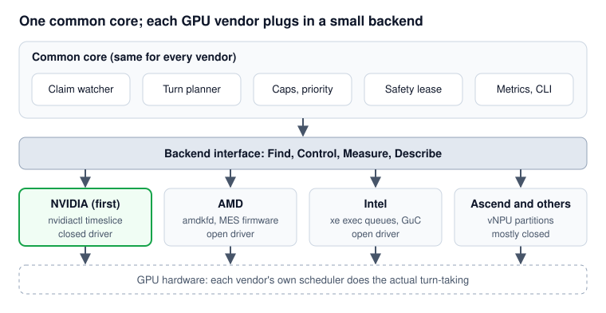

# DynaGPU: Handling GPU Vendor Differences

_Written 2026-11-07. Status: draft design._

## Summary

DynaGPU stays vendor-neutral by splitting into a **common core** that knows nothing about GPU brands and a small **backend per vendor** that talks to that vendor's driver. Build only the NVIDIA backend first; add AMD, Intel, Ascend and others once each passes the same tests.

Vendors differ in four places: how you find an app's GPU queue, which scheduling controls the driver offers, how you measure GPU time, and whether the driver is open source. The common core hides those differences behind one interface and adapts to what each backend can do.

<p align="center">
  
</p>

Only the bottom row changes per vendor; the core and the interface stay the same.

Vendor-neutral in the CNCF sense means no single company controls the project and the Kubernetes side doesn't depend on one vendor. It does not mean every GPU brand must be supported on day one.

Vendor details below are best current understanding, not tested results. Each needs its own test week on real hardware, like NVIDIA's E1–E4.

## What every backend must do

Every backend answers the same four questions; everything else lives in the common core.

1. **Find:** which GPU queue (channel group, hardware queue, exec queue) belongs to this app?
2. **Control:** set its turn length or weight, pause it, resume it.
3. **Measure:** how much GPU time did it actually get?
4. **Describe:** which of these can this GPU and driver version do?

The common core keeps claims, the turn planner, limits, priority, safety leases, metrics and the CLI. It never imports vendor code.

A first sketch of the interface in Go:

```go
// Backend is implemented once per GPU vendor.
type Backend interface {
    Name() string

    // Describe: what this device + driver can do. Called at start-up.
    Probe(dev DeviceID) (Capabilities, error)

    // Find: bind to an app's GPU queue (reported by the shim or found by the agent).
    Attach(dev DeviceID, proc ProcessRef) (QueueHandle, error)
    Detach(h QueueHandle) error

    // Control
    SetTimeslice(h QueueHandle, d time.Duration) error
    Pause(h QueueHandle) error
    Resume(h QueueHandle) error

    // Measure
    Usage(h QueueHandle) (time.Duration, error)
}

type Capabilities struct {
    WeightedTimeslice bool // per-queue turn length
    PauseResume       bool // take a queue out of rotation
    MidKernelPreempt  bool // pause a running kernel, not just between kernels
    PerQueueUsage     bool // exact GPU time per app
    PriorityOnly      bool // only coarse priority levels
    SpatialPartition  bool // split by compute units instead of time
    MinTimeslice      time.Duration
}
```

A vendor that can't do something leaves that capability false; it never fakes it.

## Vendor by vendor

NVIDIA and Intel look most direct for weighted turns; AMD is promising but may need a small driver patch; Ascend and most other accelerators need help from the vendor.

### NVIDIA (first backend)

- **Driver:** closed user-space, open kernel modules (MIT/GPL). Recent GPUs run scheduling in GSP firmware.
- **Find:** the shim inside the app records its channel group (TSG) handle when the CUDA context is created.
- **Control:** resource-manager control calls on `/dev/nvidiactl`: set timeslice (`0xa06c0103`), schedule (`0xa06c0101`), preempt (`0xa06c0105`), disable channels (`0x2080110b`). Not officially documented.
- **Measure:** NVML per-process utilisation (sampled), or the agent's own accounting from turn lengths.
- **Preemption:** compute preemption from Pascal onward, so a running kernel can be paused.
- **Main risk:** whether these controls can be issued from the agent for another process's channel group, and whether they stay stable across driver versions.
- **How to handle:** a per-driver-version table of control IDs; refuse to enforce on any untested version.

### AMD (ROCm)

- **Driver:** fully open source and in the Linux kernel (`amdgpu` + `amdkfd`). Scheduling is done by firmware (HWS on older GPUs, MES on newer ones).
- **Find:** compute queues are created per process through `/dev/kfd`; the shim can record queue IDs, and KFD exposes per-process information in sysfs.
- **Control:** queue priority and CU masking (limit an app to some compute units) exist today. The MES firmware interface has per-process and per-gang time quantum fields; whether they can be changed at runtime per app needs testing.
- **Measure:** DRM `fdinfo` reports engine time per client.
- **Preemption:** compute wave save/restore (CWSR) lets running work be paused.
- **Main risk:** weighted turns may need a small kernel patch. Because the driver is open, that patch can go upstream, which is a strength.
- **How to handle:** start with CU masking plus pause/resume, then add true weighted quantum if the test week shows it works. MI300-class GPUs also support hardware partitions, similar to MIG.

### Intel (Xe driver)

- **Driver:** fully open source (`xe`, and the older `i915`). Scheduling is done by GuC firmware.
- **Find:** apps create exec queues through the DRM uAPI; the shim can see them as they are created.
- **Control:** the uAPI lets the creating process set a per-queue priority and timeslice when the queue is created. Engine-wide timeslice and preempt timeout are also exposed in sysfs.
- **Measure:** DRM `fdinfo` reports per-client engine cycles.
- **Main risk:** the per-queue timeslice may only be settable by the owning process at creation, so the shim would have to set it once, at queue creation (not per launch).
- **How to handle:** a one-time setting from the shim at queue creation, then pause/resume from the agent for limits and priority.

### Huawei Ascend

- **Driver:** mostly closed (CANN, `npu-smi`).
- **Control:** vNPU templates split AI cores into fixed slices (spatial, like MIG). No public per-app time-slice control found.
- **How to handle:** treat it as "spatial partition only" at first and leave weighted turns to vendor collaboration. HAMi already supports Ascend vNPU, so reuse that work.

### Others (Hygon DCU, Cambricon, Moore Threads, MetaX, Iluvatar)

- **Hygon DCU** is derived from AMD's design and uses a ROCm-like stack, so it may reuse much of the AMD backend.
- The rest mostly have closed drivers and vendor-provided splitting. Add them only with a contributor or engineer from that vendor, the way HAMi does.

## Side by side

Only NVIDIA and Intel are expected to support all three DynaGPU features at launch; every entry still needs a test week.

| Vendor | Driver | Weighted turns | Hard limit (pause/resume) | Priority | Measure GPU time | Expected effort |
| --- | --- | --- | --- | --- | --- | --- |
| NVIDIA | Closed, open kernel modules | Likely (timeslice control) | Likely | Likely (preempt) | NVML, sampled | Medium: undocumented controls |
| Intel | Open (`xe`) | Likely, set at queue creation | Likely | Yes (queue priority) | DRM `fdinfo` | Medium |
| AMD | Open (`amdgpu`/`amdkfd`) | Unknown, may need kernel patch | Likely | Yes (queue priority) | DRM `fdinfo` | Medium to high |
| Hygon DCU | ROCm-like | Unknown | Unknown | Unknown | Unknown | Reuse AMD work |
| Huawei Ascend | Mostly closed | Not public | Unknown | Unknown | `npu-smi` | High, needs vendor |
| Others | Mostly closed | Not public | Unknown | Unknown | Vendor tools | High, needs vendor |

## How to handle the differences

The planner picks the best method each backend supports, tells the user honestly what level they got, and falls back to the vendor's default when nothing works.

**1. Enforcement levels.** The planner chooses the highest level the backend's capabilities allow:

| Level | Needs | How shares are enforced | Accuracy |
| --- | --- | --- | --- |
| Full | Weighted timeslice + pause/resume + preempt | GPU scheduler sets turn lengths; caps and priority by pause | Best |
| Duty-cycle | Pause/resume only | Agent pauses and resumes queues on a timer to approximate shares | Lower; coarser timing |
| Priority only | Queue priority | High/low ordering, no percentages | Ordering only |
| Partition | Spatial split (CU mask, vNPU, MIG) | Fixed slice of compute units | Fixed, no borrowing idle time |
| None | Nothing usable | Vendor default (usually equal turns) | No guarantee |

**2. Be honest in the API.** Write the level reached into the claim's status and a metric (for example `dynagpu_enforcement_level`), so a user can see "share requested 70, enforced at duty-cycle level" instead of being silently misled.

**3. Same request everywhere.** Users always ask for `compute: "70"`. Each backend turns that into its own setting (turn length, CU mask, priority). Vendor details never appear in user YAML.

**4. Fail open per backend.** Every backend uses the shared safety lease. If the agent stops, paused queues resume and the GPU returns to its default behaviour.

**5. Version tables per backend.** Each backend ships a list of tested driver and firmware versions with its control IDs. On an unknown version it reports "unsupported" and enforces nothing.

**6. Keep vendor code in its own folder.** For example `pkg/backend/nvidia`, `pkg/backend/amd`, `pkg/backend/intel`, each with its own maintainers in `OWNERS`. The core folder must not import any of them directly; backends register themselves at start-up.

## Testing

Every backend must pass one shared conformance suite before it is called supported; the pass marks are the same for every vendor.

| Test | Pass mark |
| --- | --- |
| 70/30 split, both apps busy | Within ±5% of target |
| 95/5 split (minimum-turn rule) | Within ±5% of target |
| Idle app is skipped | Busy app gets >95% of the GPU |
| Hard limit at 30% on an idle GPU | Never above 30% per window |
| Priority pause latency | Measured and published (target to set after NVIDIA week 1) |
| CUDA graph / long kernel workload | Same accuracy as small kernels |
| Agent killed mid-run | Paused apps resume within about 1 s |
| Unknown driver version | Backend refuses to enforce, reports it |
| Overhead per launch | No measurable change versus no DynaGPU |

**Support matrix.** Keep a public table of GPU model × driver version × runtime version (CUDA, ROCm, Level Zero) × result. Label each backend **stable**, **beta** or **experimental**, so users know what to trust.

**Hardware.** NVIDIA tests can run on a personal GPU or a rented cloud GPU. For AMD, Intel and Ascend, ask vendors or community members for test machines or CI runners before promising support.

## Order and step-by-step plan

Build NVIDIA first, design the interface from day one, and add each new vendor only after its own test week passes.

1. **Write the interface first.** Add the `Backend` interface and `Capabilities` to the repo before any NVIDIA code, so NVIDIA details can't leak into the core.
2. **NVIDIA test week (E1–E4).** Go/no-go for the whole project.
3. **NVIDIA backend + common core.** First release, NVIDIA only, labelled stable.
4. **Shared conformance suite.** Turn the tests above into a runnable suite that any backend can run.
5. **Second backend: Intel or AMD.** Intel looks simpler (per-queue timeslice in the open uAPI); AMD has more users. Pick whichever you can get hardware and a helper for. Run its own test week first.
6. **Third backend** (the other of Intel and AMD), then Hygon on top of the AMD work.
7. **Ascend and others** only with a vendor or community contributor, starting at the Partition level.

In the README, say: "Vendor-neutral design. NVIDIA backend first; other backends welcome."

## Open questions to check on hardware

- [ ] NVIDIA: can the agent set the timeslice on another process's channel group, or must the shim do it from inside the app?
- [ ] NVIDIA: do the controls still work on GSP-firmware GPUs and the newest driver branch?
- [ ] NVIDIA: does a longer timeslice actually give a proportional share when both apps are busy?
- [ ] AMD: can MES per-process quantum be changed at runtime, and does the GPU honour it?
- [ ] AMD: is CU masking plus pause/resume accurate enough for the Duty-cycle level?
- [ ] Intel: can an exec queue's timeslice be changed after creation, or only at creation?
- [ ] Intel: how fast is preemption on compute engines?
- [ ] Ascend: does any public interface allow per-app time control beyond vNPU templates?
- [ ] All: what is the smallest turn length that doesn't waste too much time switching?
