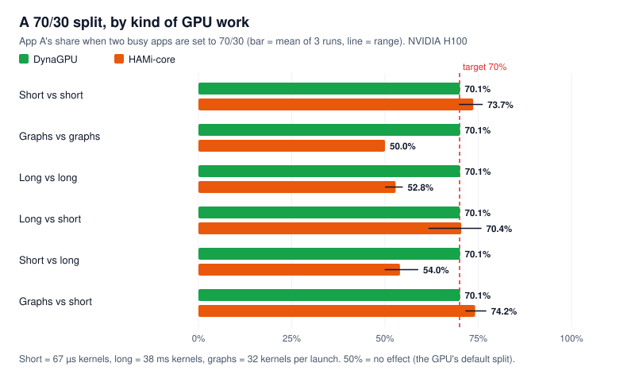
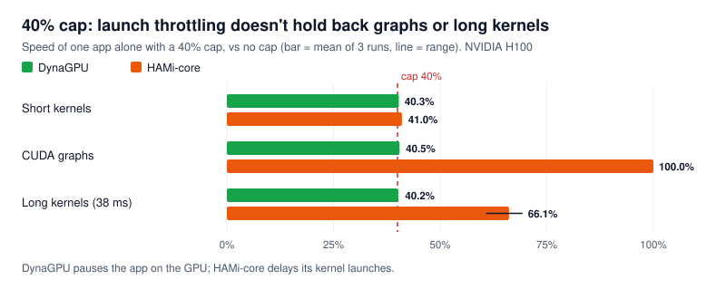

# DynaGPU vs HAMi-core, and both together

_Run 2026-11-08 on one NVIDIA H100 80GB (SXM), driver 610.57.04. This closes the HAMi-core comparison left open in [week 2 (E5)](week2.md#e5-cuda-graphs-and-long-kernels), and is the first DynaGPU run on a second GPU generation (Hopper)._

**The two tools limit GPU time in different ways, and it shows.** HAMi-core delays an app's kernel launches when its measured usage is over the limit. DynaGPU sets the GPU's own turn lengths and pauses apps on the GPU.
- **With short, separate kernels**, both hold a limit. HAMi-core's runs vary more: a 70/30 split gave 69.8–76.2%.
- **With CUDA graphs or long kernels, HAMi-core's limit mostly stops working.**
  - A 40% cap on an app using graphs gave 100%.
  - A 70/30 split of two graph apps gave 50/50.
  - A 40% cap on 38 ms kernels gave 66%.
- **DynaGPU held every case within 0.5 points.**
- **Using both works:** HAMi-core for memory, DynaGPU for time. The test also exposed a DynaGPU bug, which is now fixed.

## Summary

| Test | DynaGPU | HAMi-core |
| --- | --- | --- |
| 70/30 split, short kernels | 70.1% | 73.7% (runs 69.8–76.2%) |
| 70/30 split, **CUDA graphs** | 70.1% | **50.0%**: no effect |
| 70/30 split, **38 ms kernels** | 70.1% | **52.8%** |
| 70/30 split, PyTorch matmuls | 70.3% | 69.3% (runs 64.0–73.6%) |
| 40% cap alone, short kernels | 40.3% | 41.0% |
| 40% cap alone, **CUDA graphs** | 40.5% | **100.0%**: no effect |
| 40% cap alone, **38 ms kernels** | 40.2% | **66.1%** |
| 30% setting, nothing else on the GPU | 100.1% (a weight: spare time is used) | 31.2% (always a cap) |
| Launch cost, limit active | 2,208 ns (none loaded: 2,217) | 2,946 ns (+33%) |
| Memory limit | None (not its job) | Works: app sees 8,192 MiB, stops at 7 GiB |

## Setup

| Item | Value |
| --- | --- |
| Machine | Nebius `gpu-h100-sxm`, preset `1gpu-16vcpu-200gb` (the L40S presets had no capacity) |
| GPU | NVIDIA H100 80GB HBM3, 700 W limit, 1,980 MHz max SM clock |
| Driver / CUDA | 610.57.04 open kernel module / 13.3 |
| PyTorch | 2.15.0+cu132 |
| HAMi-core | [`Project-HAMi/HAMi-core`](https://github.com/Project-HAMi/HAMi-core) commit `1721252` (2026-11-03), built with its own `build.sh` |
| Workloads | W2 short (67 µs kernels), graphs (32 kernels per launch), long (38 ms kernels on H100); PyTorch 4096² FP16 matmuls, never idle |

Each case ran 3 times, 15 s each, the first 3 s not counted. Shares are normalised by each workload's speed alone. Full details: [`hami/environment.txt`](hami/environment.txt).

**How each tool was set up.**
- **DynaGPU:** turn lengths of 7000 / 3000 µs for a 70/30 split. Caps are enforced by the agent pausing the app for 60 ms of every 100 ms.
- **HAMi-core:** `LD_PRELOAD` plus `CUDA_DEVICE_SM_LIMIT=70` / `30`, or `CUDA_DEVICE_MEMORY_LIMIT=8g` for memory. Each app had its own `CUDA_DEVICE_MEMORY_SHARED_CACHE` file, as each container would. `GPU_CORE_UTILIZATION_POLICY` was left at its default.

**Getting HAMi-core to work outside HAMi took two steps, worth knowing:**
1. **Build with `build.sh` (a Debug build).** A plain CMake Release build adds `-fvisibility=hidden`, so `libvgpu.so` exports only `dlsym` and none of its CUDA hooks. It loads, prints its start-up messages, and limits nothing.
2. **Set `CUDA_REDIRECT` to the library's path,** or install it at `/usr/local/vgpu/libvgpu.so`. Its `dlsym` hook looks up its own functions there, and otherwise passes everything through.

Linking also needed CUDA's `libnvidia-ml` stub (`LIBRARY_PATH=/usr/local/cuda/lib64/stubs`); at runtime HAMi-core loads the real NVML itself. With both steps, HAMi-core limited CUDA 12.8 and 13.3 programs, linked statically or dynamically.

## 70/30 split

<p align="center">
  
</p>

| Case (A vs B) | DynaGPU | HAMi-core | GPU used, DynaGPU / HAMi-core |
| --- | --- | --- | --- |
| short vs short | 70.1% (70.0–70.1) | 73.7% (69.8–76.2) | 96.1% / 94.9% |
| graphs vs graphs | 70.1% (70.1–70.1) | **50.0%** (50.0–50.0) | 96.2% / 91.0% |
| long vs long | 70.1% (70.1–70.2) | **52.8%** (50.0–54.8) | 96.3% / 92.2% |
| long vs short | 70.1% (70.0–70.1) | 70.4% (61.7–75.9) | 96.2% / 94.7% |
| short vs long | 70.1% (70.1–70.1) | **54.0%** (49.9–58.9) | 96.3% / 91.8% |
| graphs vs short | 70.1% (70.1–70.1) | 74.2% (71.5–77.2) | 96.3% / 95.2% |
| PyTorch vs PyTorch | 70.3% (70.3–70.4) | 69.3% (64.0–73.6) | 96.5% / 94.4% |

Raw data: [`hami/split.csv`](hami/split.csv), [`hami/torch.csv`](hami/torch.csv).

**The pattern.** HAMi-core only gets near 70/30 when the app it must hold down to 30% (B) launches **short, separate kernels**. If B uses graphs or long kernels, its limit has little effect.
- **A graph is one launch for 32 kernels,** and HAMi-core doesn't hold back graph launches at all (50.0% every run).
- **A 38 ms kernel can't be stopped once launched,** so delaying the next launch comes too late.

DynaGPU's split doesn't depend on the kind of work, because the GPU switches apps mid-kernel on its own timer. It also left less of the GPU unused: 96% against 91–95%.

## Caps, app alone

<p align="center">
  
</p>

| Cap | Kernels | DynaGPU | HAMi-core |
| --- | --- | --- | --- |
| 20% | short | 20.5% | 20.9% |
| 40% | short | 40.3% | 41.0% |
| 80% | short | 80.1% | 80.7% |
| 40% | CUDA graphs | 40.5% | **100.0%** |
| 40% | 38 ms kernels | 40.2% | **66.1%** (60.8–69.3) |

Raw data: [`hami/cap.csv`](hami/cap.csv).

With short kernels, both hold the cap within 1 point. On the H100, DynaGPU's caps were also much closer than on the L40S (week 3 E9: up to +4.3 points). That fits the clock-boost explanation from E9: the H100's 700 W limit leaves little room for the clock to rise when the app is paused part of the time.

## Spare GPU time

One app with a 30% setting and nothing else on the GPU: **DynaGPU 100.1%, HAMi-core 31.2%** ([`hami/idle.csv`](hami/idle.csv)).

This is a design difference, not a fault. HAMi-core's setting is always a cap. DynaGPU's turn lengths are weights, so spare time goes to whoever has work, and caps are a separate option.

## Launch cost

20,000 empty launches and 5,000 launch-and-wait round trips, mean of 5 runs ([`hami/launch.csv`](hami/launch.csv)):

| Loaded | ns per launch | Round trip p50 / p99 |
| --- | --- | --- |
| Nothing | 2,217 | 7.4 / 10.6 µs |
| DynaGPU shim | 2,208 | 7.4 / 10.6 µs |
| HAMi-core, no limit | 2,272 (+2.5%) | 7.4 / 10.7 µs |
| HAMi-core, 50% limit | **2,946 (+33%)** | 7.5 / 11.0 µs |
| Both, no limits | 2,292 (+3.4%) | 7.5 / 10.7 µs |

With HAMi-core loaded but no limit, short kernels ran 0.8% slower and graphs 0.0% slower ([`hami/solo.csv`](hami/solo.csv)).

## Using both: HAMi-core for memory, DynaGPU for time

Both libraries in the same app: `LD_PRELOAD=libvgpu.so:libdynagpu_shim.so`, HAMi-core with only `CUDA_DEVICE_MEMORY_LIMIT=8g`, DynaGPU setting turns and pausing.

| Check | Result |
| --- | --- |
| Memory: what the app sees | 8,192 MiB (81,071 without HAMi-core), with or without DynaGPU |
| Memory: allocations | 7 × 1 GiB, then `cudaErrorMemoryAllocation` with HAMi-core's "OOM" message, with or without DynaGPU |
| 70/30 split | 70.1% (runs 70.1–70.2%) |
| 1,000 pause/resume cycles | Checksum matches. 51 of 2,000 calls failed, all at start-up (below) |
| **Both limiting compute at once** (HAMi-core 70/30 + DynaGPU 7000/3000) | 61.0% in one run, 75.0% in another. **Don't do this:** one tool should own compute time |

Raw data: [`hami/after-fix/`](hami/after-fix/) and [`hami/coexist_memory.csv`](hami/coexist_memory.csv).

### A DynaGPU bug this found, now fixed

In the first coexistence run, **1,981 of 2,000 pause/resume calls failed** with `0x21` (`NV_ERR_INVALID_CHANNEL`). The app wasn't paused, so its checksum matched only because nothing happened.

**Cause.** With HAMi-core loaded, the app creates and destroys two CUDA contexts at start-up before the one it uses, so the shim saw three compute channel groups. The shim never noticed objects being freed, and stopped at the first error, so a pause never reached the live group. A test **without HAMi-core** reproduced it with a program that calls `cudaDeviceReset()` twice before working:

| Context resets before work | Pause before the fix | Pause after the fix |
| --- | --- | --- |
| 0 | ok | ok, app stalls for the pause |
| 2 | `0x21`, app keeps running | ok, app stalls for the pause |
| 5 | not run | ok, app stalls for the pause |

**Fix** (in [`shim/dynagpu_shim.c`](../shim/dynagpu_shim.c)):
1. Watch `NV_ESC_RM_FREE` and forget freed channel groups, channels, subdevices and whole clients.
2. Pause and resume try every compute group and succeed if any live one succeeded; failures are logged.
3. Clear a group's slot when it is reused. The first version of the fix left a freed group's channel list in the slot. A new `dump` command, which logs what the shim tracks, showed it.

After the fix, the remaining 51 failed calls (of 2,000) came in the first 0.4 s. The shim logged 4 failures on the two throwaway contexts just before they were freed. The other errors fit the two 50–60 ms gaps when no context existed, though the agent didn't log reply times to prove it. The agent should wait for an app's context to settle before controlling it, and retry.

## DynaGPU on Hopper

Re-run of the quick checks with the fixed shim ([`hami/h100-quick/`](hami/h100-quick/)):

| Check | Result |
| --- | --- |
| E1 | 4 channel groups per context (engines 1, 11, 12, 13: one more copy engine than the L40S), GPFIFO class `0xc86f`, set and read back 7000 µs; CUDA's own value 2048 µs |
| E3 | 7:3 → 70.1% |
| E8 (1,000 pauses) | 0 errors, checksum matches; pause call p50 463 µs, p99 646 µs |

No code changes were needed for Hopper.

## Limits of this run

- One H100 and one driver. HAMi-core was used on its own, not through HAMi's device plugin and scheduler.
- `GPU_CORE_UTILIZATION_POLICY` was left at its default; `force` was not compared.
- The first coexistence run used the old shim. The after-fix numbers come from a separate run of the same section.
- Each case used 3 runs. HAMi-core's long-kernel cap has a wide spread (60.8–69.3%).
- vLLM was not tested. PyTorch was a matmul loop.

## What it means

1. **DynaGPU's main claim holds:** shares and caps that don't depend on how an app launches work. That matters most for inference servers, which rely on CUDA graphs (vLLM, TensorRT-LLM, `torch.compile`).
2. **HAMi-core and DynaGPU fit together.** HAMi-core handles memory, and DynaGPU handles time. Only one of them should limit compute.
3. **For the HAMi maintainers:**
   - HAMi-core's SM limit doesn't apply to graph launches.
   - Long kernels largely escape it.
   - A Release build silently exports no hooks.

   The first is worth an issue upstream, with these numbers.
4. **The shim must track frees** and must handle apps that recreate contexts. Fixed. The product agent should wait for a stable context before controlling an app.

## How to reproduce

```bash
cd spike/infra && terraform apply -var platform=gpu-h100-sxm -var preset=1gpu-16vcpu-200gb
# on the VM:
cd ~/DynaGPU/spike && make OGKM=$HOME/open-gpu-kernel-modules
git clone https://github.com/Project-HAMi/HAMi-core.git ~/HAMi-core
cd ~/HAMi-core && LIBRARY_PATH=/usr/local/cuda/lib64/stubs sh build.sh   # Debug build, exports the hooks
cd ~/DynaGPU/spike && python3 scripts/run_hami.py --spike $PWD --hami $HOME/HAMi-core/build/libvgpu.so \
    --py $HOME/venv/bin/python --out $PWD/results/hami
# locally:
python3 spike/scripts/plot_hami.py spike/results/hami docs/images
cd spike/infra && terraform destroy -var platform=gpu-h100-sxm -var preset=1gpu-16vcpu-200gb
```

About 60 minutes of H100 time, including the HAMi-core build investigation and the shim fix. The machine was destroyed afterwards: 0 instances, 0 disks.
