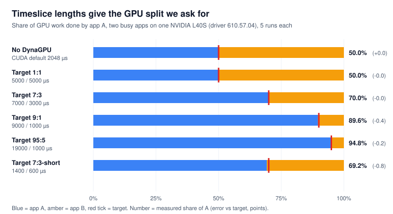

# Spike week 1 results (E1–E4)

_Run 2026-11-07 on one NVIDIA L40S. Decision: **GO** for week 2._

**Weighted GPU time-sharing through channel-group timeslices works on this GPU and driver.** Every test passed its pre-written pass mark. Across all splits, the measured GPU share was within 0.8 points of the target; the pass mark was ±5 points.

<p align="center">
  
</p>

## Verdict

| # | Question | Pass mark | Result | Verdict |
| --- | --- | --- | --- | --- |
| E1 | Can we find every context's channel group? | Every context maps to its group, for a CUDA program and PyTorch | Found for W1 and PyTorch: 3 channel groups per CUDA context (1 compute, 2 copy) | **Pass** |
| E2 | Which control route works? | The in-process route works; record the other two | In-process route works (`NV_OK`, read-back matches). Both outside routes are refused | **Pass** |
| E3 | Do turn lengths give weighted shares? | Within ±5% of target, up to 9:1 | 1:1, 7:3, 9:1 and 95:5 all within 0.4 points; worst case 0.8 points at 2 ms cycles | **Pass** |
| E4 | Is it work-conserving? | Busy app gets ≥95% of solo speed while the other idles | 95.6% with a bursty neighbour, 99.7% with an idle one | **Pass** |

Stop rules from the plan: stop if no control route works, or if E3 misses ±5%. Neither happened.

## Setup

| Item | Value |
| --- | --- |
| GPU | NVIDIA L40S, 46 GB, 142 SMs, max SM clock 2520 MHz |
| Driver | 610.57.04, **open kernel module** (Dual MIT/GPL), GSP firmware 610.57.04 |
| Driver headers | `open-gpu-kernel-modules` tag 610.57.04 (commit `e4a5faa`) |
| CUDA toolkit | 13.3 |
| PyTorch | 2.11.0+cu128 |
| OS / kernel | Ubuntu 24.04.5 LTS, 6.11.0-1016-nvidia |
| Machine | Nebius `gpu-l40s-d`, preset `1gpu-16vcpu-96gb` (AMD EPYC Genoa) |
| Xid errors in `dmesg` | 0 |

Full details: [`run1/environment.txt`](run1/environment.txt).

**Workloads**

- **W1** ([`w1_busy.cu`](../workloads/w1_busy.cu)): kernels that spin for a fixed number of cycles on every SM, kept queued back to back so the app never runs out of work. One kernel is one unit of work; we count kernels per second.
- **PyTorch** ([`torch_matmul.py`](../workloads/torch_matmul.py)): 4096×4096 FP16 matrix multiplies, synchronising every 16.

**Method.** Apps in a test start at the same wall-clock time, so their measured windows overlap exactly. Each run lasts 20 s, and the first 4 s are not counted. App A's share = A's work ÷ (A's + B's work). Efficiency = (A's + B's work) ÷ one app's solo work. Each case ran 5 times (extra checks: 3 times).

## E1: finding each app's channel group

The shim ([`dynagpu_shim.c`](../shim/dynagpu_shim.c), loaded with `LD_PRELOAD`) watches the app's `ioctl` calls on `/dev/nvidiactl`. It records every channel-group allocation (class `KEPLER_CHANNEL_GROUP_A`, `0xa06c`) together with the app's RM client handle. It only looks at one-time allocation calls, never at kernel launches.

**Result:** every CUDA context creates **3 channel groups**:

| Engine type | Engine | Gets a DynaGPU timeslice? |
| --- | --- | --- |
| 1 | `GRAPHICS` / `GR0`: compute and graphics | Yes |
| 11 | `COPY2` | No, copy engines run on their own runlists |
| 12 | `COPY3` | No |

Same for W1 and PyTorch (1 process in `nvidia-smi`, 1 compute channel group found). Logs: [`e1_w1_shim.log`](run1/e1_w1_shim.log), [`e1_pytorch_shim.log`](run1/e1_pytorch_shim.log).

**Important finding: CUDA sets its own timeslice.** Right after creating the compute channel group, the CUDA driver calls `SET_TIMESLICE` itself with **2048 µs**. A value set by DynaGPU at creation time would be overwritten a moment later. The shim therefore also catches CUDA's own call and replaces the value with DynaGPU's.

## E2: which control route works

| Route | How | Result (normal user and root) |
| --- | --- | --- |
| **A. In-process** | The shim sends `NVA06C_CTRL_CMD_SET_TIMESLICE` (`0xa06c0103`) on the app's own fd and RM client | **Works.** Status `NV_OK`; `GET_TIMESLICE` reads back the exact value (for example 7000 µs) |
| B. Outside, direct | A separate process uses the app's client and channel-group handles on its own `/dev/nvidiactl` fd | Refused: `0x23 NV_ERR_INVALID_CLIENT`. An RM client belongs to the file that created it |
| C. Outside, duplicate | The agent creates its own RM client and device (both succeed), then duplicates the app's channel group with `NV_ESC_RM_DUP_OBJECT` | Refused at the duplicate step: `0x1b NV_ERR_INSUFFICIENT_PERMISSIONS`, even as root |

Raw output: [`e2_agent_probe.txt`](run1/e2_agent_probe.txt).

The driver source agrees. It registers `SET_TIMESLICE` with flags `0x10008`, which includes `RMCTRL_FLAGS_NON_PRIVILEGED`. So an ordinary process may change the timeslice of **its own** channel group, but not another process's.

**What this means for the design.** Enforcement has to run inside each app, through the shim. The node agent decides the values and tells each app's shim what to set; it cannot set them directly. The spike shim already supports this through a control file (`DYNAGPU_CTL`), and the runtime check below shows it works. It also confirms accepted limit 2 from the design review: a hostile app could raise its own timeslice. DynaGPU is not a security boundary.

## E3: weighted shares

Two W1 apps, both always busy, timeslices set by the shim.

| Split | Timeslices A / B (µs) | Cycle | Target A | Measured A (mean of 5) | Error | Spread (sd) | Efficiency |
| --- | --- | --- | --- | --- | --- | --- | --- |
| No DynaGPU | 2048 / 2048 (CUDA default) | 4.1 ms | 50% | 50.0% | +0.0 pts | 0.000 | 96.5% |
| 1:1 | 5000 / 5000 | 10 ms | 50% | 50.0% | −0.0 pts | 0.000 | 97.9% |
| 7:3 | 7000 / 3000 | 10 ms | 70% | 70.0% | −0.0 pts | 0.000 | 97.9% |
| 9:1 | 9000 / 1000 | 10 ms | 90% | 89.6% | −0.4 pts | 0.000 | 98.2% |
| 95:5 | 19000 / 1000 | 20 ms | 95% | 94.8% | −0.2 pts | 0.000 | 98.8% |
| 7:3, short turns | 1400 / 600 | 2 ms | 70% | 69.2% | −0.8 pts | 0.000 | 94.1% |

Raw data: [`e3_weighted.csv`](run1/e3_weighted.csv), [`default_pair.csv`](run1/default_pair.csv).

Observations:

- **Results repeat almost exactly.** The 5 runs of each split agree to the third decimal place.
- **The small error grows as turns get shorter.** It is 0.0 points at 7 ms / 3 ms, and 0.8 points at 1.4 ms / 0.6 ms. The minimum-turn rule in the design (turns of about 1 ms or more) is the right call.
- **Switching costs GPU time, and shorter cycles cost more.** Total throughput was 94.1% of solo at a 2 ms cycle, 96.5% at CUDA's default (4.1 ms cycle), and 97.9–98.8% at 10–20 ms. DynaGPU's 10 ms cycle loses **less** than CUDA's default turns do.

## E4: work conservation

App A has the small share (3000 µs); app B has the large share (7000 µs) but is mostly idle.

| Case | B's behaviour | A's speed vs solo (mean of 5) | Worst run | Verdict |
| --- | --- | --- | --- | --- |
| Bursty neighbour | B runs 5 ms of work every 100 ms | 95.6% | 95.5% | Pass (B used about 1.9% of the GPU itself) |
| Idle neighbour | B runs 1 ms of work every second | 99.7% | 99.7% | Pass |

Raw data: [`e4_work_conserving.csv`](run1/e4_work_conserving.csv).

A large timeslice is a maximum, not a reservation: an app that has no work gives up the GPU straight away.

## Extra checks

| Check | Target A | Measured A (mean of 3) | Notes |
| --- | --- | --- | --- |
| Change timeslices **while the apps run**: start with CUDA's 2048 µs, then write 7000 / 3000 to each shim's control file | 70% | 69.8% | The runtime path works; the shim logs `SET_TIMESLICE ... OK` about 5 s after start |
| PyTorch, default timeslices | 50% | 50.0% | Same as W1 |
| PyTorch, 7000 / 3000 µs | 70% | 66.7% | Within ±5, but 3.3 points short. Explained below |

Raw data: [`extra.csv`](run1/extra.csv).

**Why PyTorch fell short (unconfirmed).** The PyTorch script waits for the GPU after every 16 matrix multiplies, about 10 ms of work. During that pause app A has nothing queued, so it gives up the rest of its turn and app B uses it. That is work conservation doing its job, but it means a real app gets less than its share when it stops itself. This has to be measured in week 2 (E5, real workloads with CUDA graphs and long kernels). If it holds, the agent will need to correct for it, for example by measuring each app's GPU time and adjusting its turns.

## Overhead of the shim

| Case | Kernels per second (mean of 5) | Spread (sd) |
| --- | --- | --- |
| W1 solo, no shim | 12,243.0 | 59.5 |
| W1 solo, with shim | 12,234.3 | — |

The difference is 0.07%, well inside the run-to-run spread of about 0.5%. **There's no measurable per-launch overhead**, as expected: the shim only acts on one-time allocation and control calls. Raw data: [`solo.csv`](run1/solo.csv).

## Limits of this run

- One GPU model (L40S, Ada) and one driver (610.57.04). The design's test matrix still needs H100/A100 and older drivers (E12: driver 535 to 595+).
- W1 is synthetic. PyTorch was a single matrix-multiply loop. vLLM, CUDA graphs and long kernels are week-2 tests (E5).
- Not tested yet: preemption latency (E6), cost at many apps (E7), correctness over 10,000 pauses (E8), hard caps (E9), agent failure (E10), NCCL (E11).
- Only two apps at a time.

## What we learned for the design

1. **Control must go through the shim inside each app.** Outside routes are refused by the driver. The agent decides and the shim applies.
2. **The shim must override CUDA's own 2048 µs timeslice.** CUDA sets it right after creating the channel group.
3. **Only the compute channel group** (engine type 1) gets a timeslice. Each context also has two copy-engine groups.
4. **Keep turns at 1 ms or more** and a cycle of about 10 ms. That is both accurate and cheaper than CUDA's default.
5. **Apps that pause themselves get less than their share.** Week 2 must measure this with real workloads.

## How to reproduce

See [`../README.md`](../README.md). In short:

```bash
cd spike/infra && terraform apply                 # one L40S VM on Nebius
# on the VM:
git clone --depth 1 --branch "$(cat /sys/module/nvidia/version)" \
    https://github.com/NVIDIA/open-gpu-kernel-modules.git ~/open-gpu-kernel-modules
cd ~/DynaGPU/spike && make OGKM=$HOME/open-gpu-kernel-modules
python3 scripts/run_spike.py --bin $PWD/workloads/w1_busy \
    --shim $PWD/shim/libdynagpu_shim.so --out $PWD/results/run1
# back on your machine:
cd spike/infra && terraform destroy
```

About 45 minutes of L40S time in total, including setup.
