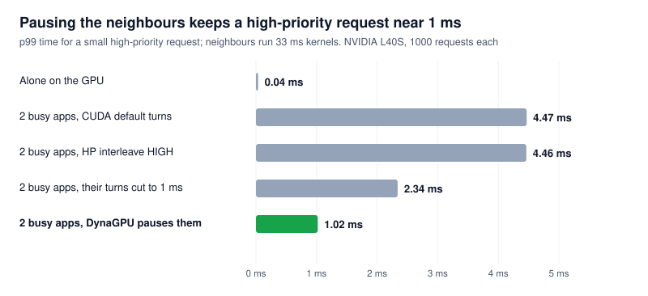
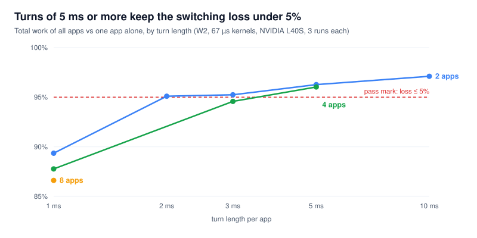

# Spike week 2 results (E5–E8)

_Run 2026-11-07 on one NVIDIA L40S. Decision: **GO** for week 3, with one design change: a minimum turn of 5 ms, and priority handled by pausing rather than by short turns._

**Shares held for CUDA graphs and long kernels, pausing is fast and safe, and the PyTorch shortfall from week 1 is explained.** One test failed its pass mark. At 1 ms turns, switching costs 10.6–13.4% of total throughput, against a limit of 5%. With turns of 5 ms or more, the loss stays under 5%.

## Verdict

| # | Question | Pass mark | Result | Verdict |
| --- | --- | --- | --- | --- |
| E5 | Do shares hold with CUDA graphs and long kernels? | Within ±5 points; compare with HAMi-core | All 6 weighted cases within 0.7 points. HAMi-core comparison run later on an H100 ([results](hami-comparison.md)): its limit had no effect on CUDA graphs and little on long kernels | **Pass** |
| E6 | How fast is preemption? | Pausing adds ≤1 ms to p99 start delay | +962 µs (short-kernel neighbours), +985 µs (33 ms-kernel neighbours) | **Pass, narrowly** |
| E7 | What does it cost? | ≤5% throughput loss at ≥1 ms turns; no launch-latency change | Loss 10.6% (2 apps), 12.2% (4), 13.4% (8) at 1 ms. Under 5% from 2 ms (2 apps) and 5 ms (4 apps). Launch latency unchanged | **Fail at 1 ms**; pass at ≥5 ms |
| E8 | Does work resume correctly? | 10,000 pause cycles, identical outputs, no Xid, no hangs | 2 × 10,000 cycles, checksums identical, 0 Xid, 0 hangs, 0 failed calls | **Pass** |

Stop rules from the plan: stop after week 2 if pausing ever corrupts output (E8). That did not happen.

## Setup

Same machine type as week 1: NVIDIA L40S, driver **610.57.04 open kernel module**, CUDA 13.3, Ubuntu 24.04.5, Nebius `gpu-l40s-d`. PyTorch was **2.15.0+cu132** this time; week 1 used 2.11. Details: [`week2/environment.txt`](week2/environment.txt).

**New workload W2** ([`w2_work.cu`](../workloads/w2_work.cu)). Each kernel runs a fixed number of dependent integer steps per thread. W1's kernels spin on the clock, so a long W1 kernel that is paused would count its paused time as work. W2 counts **work done**, so it stays correct when kernels are preempted mid-run. Its final GPU state depends only on how many kernels ran, which makes it the correctness check for E8.

| Config | Kernel length | Solo speed |
| --- | --- | --- |
| `short` (`--iters 4000`) | ≈ 67 µs | 14,561 kernels/s |
| `long` (`--iters 2000000`) | ≈ 33 ms (longer than any turn) | 29.3 kernels/s |
| `graph` (32 short kernels per CUDA graph) | one launch ≈ 2.2 ms | 14,367 kernels/s |

**Share with mixed kernel sizes.** Each app's speed is divided by its own solo speed first: share A = (A ÷ A solo) ÷ (A ÷ A solo + B ÷ B solo).

## New: how to pause an app

DynaGPU needs a way to stop an app's GPU work immediately and start it again. We tried two driver controls:

| Control | Driver flags | Result |
| --- | --- | --- |
| `NVA06C_CTRL_CMD_GPFIFO_SCHEDULE` (`0xa06c0101`), `bEnable=false`, then `PREEMPT` (`0xa06c0105`), on the channel group | non-privileged | Returns `NV_OK` but **does nothing**: the app kept full speed through a 5 s "pause". On GSP-based GPUs the call is forwarded to the firmware, which apparently ignores it for a running group |
| `NV2080_CTRL_CMD_FIFO_DISABLE_CHANNELS` (`0x2080110b`) on the app's subdevice, listing the group's channels | non-privileged (`0x10108`) | **Works.** A 5 s pause cut throughput by exactly 5 s' worth. Pause ≈ 0.4 ms, resume ≈ 0.3 ms |

The shim now also records the app's subdevices and the GPFIFO channels inside each compute channel group. On this GPU each compute group has **8 channels** of class `0xc56f`. The agent talks to the shim over a Unix datagram socket (`DYNAGPU_SOCK`), with the commands `pause`, `resume`, `ts <µs>` and `il <level>`.

**Bug found and fixed on the way.** CUDA sometimes creates a short-lived driver client first, with its own subdevice, and then does its real work under a second client. The shim first used the first subdevice it saw, which failed with `NV_ERR_INVALID_CLIENT` (`0x23`) for some apps. It now uses the subdevice of the same client that owns the channel group.

## E5: CUDA graphs and long kernels

Two apps, timeslices 7000 / 3000 µs (target 70% for A), 5 runs each.

| Case | A | B | Measured A | Error | Spread (sd) |
| --- | --- | --- | --- | --- | --- |
| Control | short | short | 70.1% | +0.08 pts | 0.000 |
| **CUDA graphs** | graph | graph | 70.1% | +0.09 pts | 0.000 |
| **Long kernels** | long | long | 70.1% | +0.15 pts | 0.001 |
| Long vs short | long | short | 70.7% | +0.68 pts | 0.000 |
| Short vs long | short | long | 69.5% | −0.54 pts | 0.000 |
| Graph vs short | graph | short | 70.6% | +0.56 pts | 0.000 |
| No DynaGPU (CUDA default turns) | long | short | 50.7% (target 50%) | +0.66 pts | 0.000 |

Raw data: [`e5_graphs_long.csv`](week2/e5_graphs_long.csv).

Shares hold because the GPU's scheduler measures time itself and switches apps in the middle of a kernel. It doesn't matter that a graph is one launch of 32 kernels, or that one kernel runs for 33 ms, which is 4.7× longer than the 7 ms turn.

**Not done: the comparison with HAMi-core.** The plan asks for a run where HAMi-core's limiter fails and DynaGPU doesn't. We cloned HAMi-core (commit `1721252`). Its library build was stopped by this session's safety policy, which blocks compiling and running outside code without the user's approval. Its test programs had also failed to link. With approval, the comparison is about 15 minutes of GPU time: the same cases with `CUDA_DEVICE_SM_LIMIT=70/30`.

## Week-1 PyTorch shortfall: explained

Week 1 measured 66.7% for a 70% target with PyTorch. The guess was that the script's own waits made it give up the rest of its turn. Two PyTorch apps at 7000 / 3000 µs, 3 runs each:

| PyTorch pattern | Measured A | Error |
| --- | --- | --- |
| Wait for the GPU every 16 matmuls (week 1) | 66.7% | −3.33 pts |
| Wait every 256 matmuls | 69.7% | −0.34 pts |
| Never idle (keep 4 batches queued with events) | 70.4% | +0.39 pts |
| CUDA graph, never idle | 70.4% | +0.43 pts |

Raw data: [`torch_shortfall.csv`](week2/torch_shortfall.csv).

**Confirmed.** The shortfall comes from the app's own idle gaps, not from DynaGPU or PyTorch. An app that waits for the GPU gives up the rest of its turn, and the other app uses it. That is work conservation, but it means an app that pauses itself often gets less than its share. To guarantee shares for such apps, the agent will have to measure each app's actual GPU time and adjust turn lengths. That is the same measurement hard caps need (E9).

## E6: priority latency

A high-priority app (HP) sends 1000 small requests, one every 10 ms. Each request is a small kernel, about 26 µs end to end when HP is alone, and HP waits for the result. Two low-priority apps (LP) keep the GPU busy.

<p align="center">
  
</p>

| Case | LP kernels | p50 | p99 | max |
| --- | --- | --- | --- | --- |
| HP alone | — | 26 µs | 36 µs | 49 µs |
| CUDA default turns (2048 µs) | short | 2.31 ms | 4.47 ms | 4.51 ms |
| LP turns cut to 1 ms | short | 1.25 ms | 2.33 ms | 2.38 ms |
| HP interleave level HIGH | short | 2.34 ms | 4.48 ms | 4.54 ms |
| **DynaGPU pauses the LP apps per request** | short | **0.83 ms** | **1.00 ms** | 5.00 ms |
| CUDA default turns | long (33 ms) | 2.27 ms | 4.47 ms | 4.51 ms |
| LP turns cut to 1 ms | long | 1.27 ms | 2.34 ms | 2.38 ms |
| HP interleave level HIGH | long | 2.32 ms | 4.46 ms | 4.53 ms |
| **DynaGPU pauses the LP apps per request** | long | **0.85 ms** | **1.02 ms** | 2.36 ms |

Raw data: [`e6_latency.csv`](week2/e6_latency.csv), plus one CSV per case with all 1000 requests.

Observations:

- **Pausing passes, narrowly.** It adds 962 µs (short) and 985 µs (long) to p99, against a 1,000 µs limit. Almost all of that is the pause call itself: 0.75 ms at p50 and 0.92 ms at p99, for two apps paused in parallel. One request in 1000 took 5.0 ms (short) and one took 2.4 ms (long).
- **Pausing works the same in the middle of a 33 ms kernel.** The GPU's compute preemption saves the kernel's state.
- **The interleave level did nothing here.** Setting HP to `HIGH` (accepted, non-privileged) gave the same latency as the default.
- **Short turns help, but less than pausing.** Cutting the LP turns to 1 ms halved the latency to 2.3 ms p99, but E7 shows that 1 ms turns cost over 10% of throughput.

**What it means.** Priority should come from pausing, not from short turns. The pause call is the cost: about 0.4 ms per app, and calls to several apps partly serialise in the driver. Ways to cut it in week 3: keep low-priority apps paused while the high-priority app is busy, so there is one pause per burst rather than per request; or pause ahead of time when the agent knows work is coming. The open question remains how the agent learns that a high-priority app has new work without intercepting launches.

## E7: cost

**Throughput.** Several W2 `short` apps, all always busy. Total work of all apps vs one app alone, 3 runs each.

<p align="center">
  
</p>

| Apps | Turn length | Total vs solo | Loss | Within 5%? |
| --- | --- | --- | --- | --- |
| 2 | 1 ms | 89.4% | 10.6% | No |
| 2 | 2 ms | 95.1% | 4.9% | Yes, barely |
| 2 | 3 ms | 95.2% | 4.8% | Yes, barely |
| 2 | 5 ms | 96.3% | 3.7% | Yes |
| 2 | 10 ms | 97.1% | 2.9% | Yes |
| 4 | 1 ms | 87.8% | 12.2% | No |
| 4 | 3 ms | 94.6% | 5.4% | No |
| 4 | 5 ms | 96.0% | 4.0% | Yes |
| 8 | 1 ms | 86.6% | 13.4% | No |
| 4 | CUDA default (2048 µs) | 92.7% | 7.3% | No |

Raw data: [`e7_cost.csv`](week2/e7_cost.csv), [`e7_sweep.csv`](week2/e7_sweep.csv).

**Launch cost.** 20,000 empty-kernel launches, and 5,000 launch-and-wait round trips, 5 runs each:

| | Host time per launch | Round trip p50 | Round trip p99 |
| --- | --- | --- | --- |
| Without shim | 1,616 ns | 5.2 µs | 9.2 µs |
| With shim | 1,631 ns | 5.2 µs | 9.3 µs |

Raw data: [`e7_launch.csv`](week2/e7_launch.csv). That difference (about 1%) is within the run-to-run spread, and the round trips are identical. The shim doesn't touch launches.

Observations:

- **1 ms turns are too short.** The design's minimum of about 1 ms costs over 10%. Even CUDA's own default of 2048 µs loses 7.3% with 4 apps.
- **The loss jumps between 1 ms and 2 ms** (10.6% to 4.9%), then barely changes up to 3 ms. That doesn't look like a smooth "cost per switch". The driver documents that timeslices are rounded down to a valid hardware value, so this may be rounding; not checked.
- Week 1's W1 lost less at short turns (5.9% at 1.4 / 0.6 ms). W2's kernels keep more state per thread, so saving and restoring them may cost more; not checked.

**Design change.** Raise the minimum turn to **5 ms**, with a cycle of at least `5 ms × number of busy apps`. Shares are still exact (E3, E5), and priority comes from pausing (E6), so long turns don't hurt latency for urgent work.

## E8: correctness under 10,000 pauses

One W2 app runs a fixed number of kernels next to a busy competitor. Every 5 ms the agent pauses it (`DISABLE_CHANNELS` + preempt), waits 2 ms and resumes it, 10,000 times. The final GPU state is compared with a reference run without pauses.

| Case | Kernels | Reference time | Time with pauses | Pause cycles OK | Checksum | New Xid | Hang |
| --- | --- | --- | --- | --- | --- | --- | --- |
| 10 ms kernels | 2,500 | 25.8 s | 81.4 s | 10,000 / 10,000 | `15beee6a0058383a`, **identical** | 0 | No |
| 33 ms kernels (every pause lands mid-kernel) | 900 | 30.9 s | 92.4 s | 10,000 / 10,000 | `1c0e2ab7c84a3b45`, **identical** | 0 | No |

Raw data: [`e8_correctness.csv`](week2/e8_correctness.csv), plus every cycle's timings in `e8-cycles-*.csv`.

**Pause and resume call times** (agent side, including the socket round trip):

| Case | Pause p50 / p99 / p99.9 | Resume p50 / p99 / p99.9 | Calls > 10 ms |
| --- | --- | --- | --- |
| 10 ms kernels | 408 / 616 / 842 µs | 327 / 470 / 727 µs | 1 pause (12 ms), 1 resume (179 ms) |
| 33 ms kernels | 400 / 595 / 833 µs | 319 / 465 / 841 µs | 2 resumes (up to 190 ms) |

**A rare slow call.** 3 of 40,000 calls took between 12 and 190 ms. They still succeeded, and didn't affect correctness. The cause is unknown: the shim's socket thread being scheduled late, the driver lock, or the GSP firmware. Week 3's safety lease (E10) must cope with a control call that occasionally takes about 200 ms.

## Limits of this run

- One GPU model (L40S, Ada), one driver (610.57.04). E12 (driver 535 to 610) is still to do.
- No HAMi-core comparison (blocked, see E5).
- No vLLM. PyTorch was a matmul loop, with and without CUDA graphs.
- E6 used up to 2 low-priority apps. Pause time grows with the number of apps.
- The slow-call tail in E8 is not explained.

## What we learned for the design

1. **Pause with `DISABLE_CHANNELS`, not `GPFIFO_SCHEDULE`.** On this GSP-based GPU, the channel-group schedule switch returns OK but does nothing.
2. **The shim must track subdevices per client.** CUDA can create a short-lived client first.
3. **Minimum turn 5 ms, not 1 ms.** At 1 ms switching costs 10–13%; at 5 ms it costs 4%.
4. **Priority comes from pausing.** p99 about 1 ms against 4.5 ms with default turns. Short turns and the interleave level are not substitutes.
5. **The pause call costs about 0.4 ms per app.** Pause once per high-priority burst, not once per request.
6. **Shares are exact only for apps that stay busy.** Apps that wait on the GPU give up the rest of their turn, so guaranteeing their share needs per-app GPU-time measurement. That is the same work as caps (E9).
7. **Control calls can occasionally take about 200 ms.** Leases and timeouts must allow for it.

## How to reproduce

```bash
cd spike/infra && terraform apply
# on the VM (driver headers + PyTorch as in spike/README.md):
cd ~/DynaGPU/spike && make OGKM=$HOME/open-gpu-kernel-modules
python3 scripts/run_week2.py --spike $PWD --py $HOME/venv/bin/python --out $PWD/results/week2
python3 scripts/run_e7_sweep.py --spike $PWD --out $PWD/results/week2
# locally:
python3 spike/scripts/plot_week2.py spike/results/week2 docs/images
cd spike/infra && terraform destroy
```

About 70 minutes of L40S time in total, including setup and debugging.
