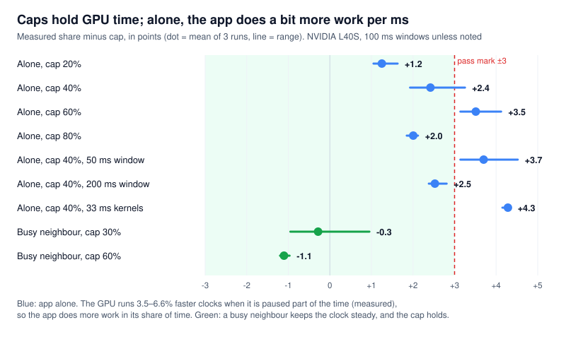
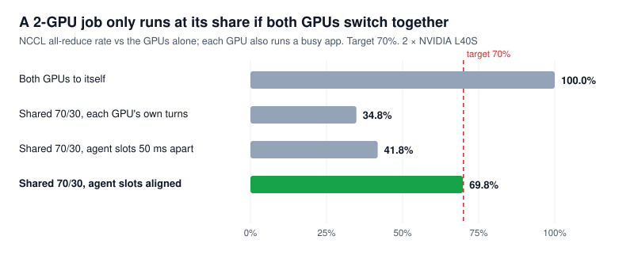

# Spike week 3 results (E9–E12)

_Run 2026-11-08 on a Nebius machine with two NVIDIA L40S GPUs. Decision: **GO** to build the first release. The plan's rule was "go if E1–E8 and E10 pass, with E9 and E11 failures documented as limits". E10 passed, and E9 and E11 passed with findings that change the design._

**The safety lease works, the driver interface is stable from driver 535 to 620, and multi-GPU jobs survive pausing.** Three findings change the design:
- **Caps hold GPU time but not always work.** An app capped while alone does up to 4.3 points more work than its cap, because the GPU runs at a higher clock when it is paused part of the time.
- **Multi-GPU jobs need their GPUs to switch together.** Otherwise a 2-GPU NCCL job shared 70/30 runs at only 34.8% of its speed, not 70%.
- **The shim had a multi-GPU bug.** It was found and fixed on the first run.

## Verdict

| # | Question | Pass mark | Result | Verdict |
| --- | --- | --- | --- | --- |
| E9 | Can we enforce a hard cap? | Within 3 points of the cap | With a busy neighbour: within 1.1 points. Alone: +1.2 to +4.3 points of extra *work*, explained by higher GPU clocks (+3.5% to +6.6%, measured). In GPU time, within about 1.6 points | **Pass for GPU time**; work overshoots when the app is alone |
| E10 | What if the agent dies? | Each app resumes itself when its 1 s lease runs out | Paused app resumed after 1.048–1.049 s (5 of 5). Turn lengths reset to CUDA's default after 1.042–1.045 s (3 of 3). A healthy agent held 15 of 15 long pauses with 0 false expiries | **Pass** |
| E11 | Does NCCL survive? | No errors; pausing both ranks stops the peer from spinning | 0 errors and 0 hangs over 600 pause cycles. Pausing one rank leaves the other GPU 100% busy spinning; pausing both brings both to 0% | **Pass**. New limit: needs aligned turns (see below) |
| E12 | Is the driver interface stable? | Control IDs and structures unchanged from 535 to 595, or a small per-version table | IDs, ioctl numbers and every field the shim uses are identical in all 15 versions from 525 to 620. All controls are non-root in every version. Runtime checks pass on 535, 570, 580 and 610 | **Pass**, no per-version table needed for 535–620 |

## Setup

| Item | Value |
| --- | --- |
| Machine | Nebius `gpu-l40s-d`, preset `2gpu-64vcpu-384gb` (AMD EPYC Genoa) |
| GPUs | 2 × NVIDIA L40S, PCIe, no NVLink (topology `PHB`) |
| Driver | 610.57.04 open kernel module for E9–E11; 580.196.07, 570.211.01, 535.309.01 for E12 |
| CUDA | 13.3; 12.8 to build for drivers older than 580 |
| PyTorch / NCCL | 2.15.0+cu132 / 2.30.7 |
| Xid errors | 0 |

Full details: [`week3/environment.txt`](week3/environment.txt). Workload W2 and the short kernels (`--iters 4000`, about 67 µs) are as in week 2.

## New in the shim

| Change | Why |
| --- | --- |
| **Safety lease** (`DYNAGPU_LEASE_MS`) | Once the agent has sent a command, every command renews the lease. If the lease runs out while the app is paused or has a changed turn length, the shim resumes the app and restores CUDA's own turn length by itself. A watchdog thread checks every 50 ms |
| **`hb` command** | A heartbeat that only renews the lease |
| **`%p` in `DYNAGPU_SOCK`** | Replaced by the process ID, so processes started with the same environment (such as `torchrun` ranks) each get their own socket |
| **Fix: subdevice matched by GPU** | On a 2-GPU machine CUDA creates one device and one subdevice per GPU under the same client. The shim used the last one (GPU 1's) for an app on GPU 0, and `pause` failed with `0x21`. The shim now picks the subdevice with the same client **and** parent device as the channel group. Week 2 ran on one GPU, so it never showed up |

## E9: hard caps

The agent enforces a cap by pausing: in each window (100 ms unless noted), an app capped at 40% runs 40 ms and is paused for 60 ms. With a busy neighbour the slots are exclusive: the neighbour is paused while the capped app runs. Share = the app's kernels per second ÷ its kernels per second alone. 3 runs each.

<p align="center">
  
</p>

| Case | Cap | Measured (mean of 3) | Error | Worst run |
| --- | --- | --- | --- | --- |
| Alone | 20% | 21.3% | +1.25 pts | +1.63 |
| Alone | 40% | 42.4% | +2.42 pts | +3.25 |
| Alone | 60% | 63.5% | +3.51 pts | +4.12 |
| Alone | 80% | 82.0% | +2.01 pts | +2.12 |
| Alone, 50 ms window | 40% | 43.7% | +3.70 pts | +4.52 |
| Alone, 200 ms window | 40% | 42.5% | +2.52 pts | +2.81 |
| Alone, 33 ms kernels | 40% | 44.3% | +4.28 pts | +4.35 |
| **Busy neighbour** | 30% | 29.7% | −0.29 pts | −0.95 |
| **Busy neighbour** | 60% | 58.9% | −1.11 pts | −1.20 |

Raw data: [`e9_caps.csv`](week3/e9_caps.csv).

**Why an app alone does more work than its cap.** Running flat out, the L40S sits at its 350 W power limit (throttle reason `0x4`, software power cap) and runs at about 2,300 MHz. When it is paused part of the time it stays under the limit and clocks higher:

| Case | SM clock while busy | Mean power |
| --- | --- | --- |
| Flat out | 2,307 MHz (repeat: 2,283) | 350 W |
| Cap 40% | 2,460 MHz (+6.6%) | 195 W |
| Cap 80% | 2,389 MHz (+3.5%) | 265 W |

Raw data: [`e9_clocks.csv`](week3/e9_clocks.csv). (That check's own work share is not valid: its agent stopped about 2 s before the app ended.)

Dividing by the clock gain gives the GPU *time* the app got: 42.4% ÷ 1.066 = **39.8%** for the 40% cap, and 82.0% ÷ 1.035 = **79.2%** for the 80% cap. The 33 ms-kernel and 50 ms-window cases, with the 40% clock gain, come to about 41.6% and 41.0%. That remaining 1–1.6 points is not fully explained. The pause call accounts for part of it: it takes about 0.4 ms per window, and the app keeps running meanwhile. With a busy neighbour the GPU never idles, the clock stays steady, and the cap holds within 1.1 points.

**What it means.** A cap is a limit on **GPU time**. It can't promise "at most 40% of the work the GPU could do flat out", because how much work fits in a millisecond depends on clock speed, power and the other apps. The README and API should say "share of GPU time".

**NVML can't measure per-app usage here.** Caps need a source of each app's GPU time, so we compared `nvidia-smi pmon` (per-process SM %) with the real shares. For two steady weighted apps, its *ratio* was right (52:22 for a true 67.5:28.8), but the absolute values were 20–30% low. With pausing it was unusable: an app capped at 20% read 0–15%, and with a neighbour, pmon often gave all the time to one process (for example 76.8% and 0.0% for a true 29% and 69%). Raw data: [`e9_nvml_accuracy.csv`](week3/e9_nvml_accuracy.csv). The agent will need its own accounting: it knows exactly when it paused and resumed each app.

**Small loose end.** Each 20 s run had 1–2 failed agent calls out of 211–843. They are most likely the last call of the run, sent as the app exited, but that's not proven. One missed pause would add at most 0.3 points.

## E10: the agent dies

**(a) The agent pauses an app, then is killed (SIGKILL).** A second app with no shim keeps the GPU busy. 5 runs.

| Run | App resumed after the agent's last command | Lease expiry logged by the shim | A new agent can pause it afterwards |
| --- | --- | --- | --- |
| 1–5 | **1.048–1.049 s** | 1.046–1.048 s | Yes, 5 of 5 |

The extra 48 ms over the 1 s lease is the watchdog's 50 ms check interval.

**(b) The agent sets 9:1 turns (9000 / 1000 µs) on two busy apps, heartbeats for 6 s, then is killed.** 3 runs.

| Run | A's share while the agent lived | A's share after the lease ran out | Reset after the last heartbeat |
| --- | --- | --- | --- |
| 1 | 90.1% | 50.0% | 1.045 s |
| 2 | 90.2% | 50.0% | 1.042 s |
| 3 | 90.1% | 50.0% | 1.044 s |

After the lease, both apps are back on CUDA's own 2048 µs turns, so they share equally.

**(c) A healthy agent must not trip the lease.** For 60 s the agent paused an app for 3 s at a time (3× the lease), sending a heartbeat every 250 ms, then resumed it for 1 s. Result: **15 of 15 pauses held with no progress, 0 false lease expiries, 0 agent errors.**

Raw data: [`e10_lease.csv`](week3/e10_lease.csv) and the `e10*` shim logs.

## E11: NCCL

Two ranks with `torchrun`, one per GPU, each doing 64 MiB all-reduces in a loop. Every step fills the tensor with `rank + 1`, all-reduces it and checks every element equals 3, so a corrupted or half-finished collective is caught. The ranks agree on when to stop (an all-reduce of a stop flag), so neither leaves mid-collective. The shim is loaded in both ranks.

| Case | Steps | Check errors | Step p50 / p99 / max | NCCL errors | Hang |
| --- | --- | --- | --- | --- | --- |
| Baseline, 30 s | 8,801 | 0 | 3.30 / 3.36 / 29 ms | 0 | No |
| Pause rank 0, rank 1, then both, 5 s each | 7,353 | 0 | 3.29 / 3.35 / 5,005 ms | 0 | No |
| 300 pauses of both ranks together (50 ms) | 13,069 | 0 | 3.29 / 54.6 / 205 ms | 0 | No |
| 300 pauses of rank 0 only (50 ms) | 13,028 | 0 | 3.30 / 54.1 / 197 ms | 0 | No |
| Each GPU shared 7:3 with a busy app | 3,065 | 0 | 6.53 / 6.59 / 35 ms | 0 | No |

Raw data: [`e11_nccl.csv`](week3/e11_nccl.csv).

**Who spins.** GPU utilisation from `nvidia-smi`, averaged over the middle of each 5 s window:

| Window | GPU 0 | GPU 1 |
| --- | --- | --- |
| Rank 0 paused | 0% (102 W) | **100%** (102 W) |
| Rank 1 paused | **100%** (102 W) | 0% (102 W) |
| Both paused | 0% (101 W) | 0% (102 W) |
| Running | 97% (121 W) | 97% (124 W) |

Pausing one rank leaves the other rank's NCCL kernel resident and waiting: its GPU shows 100% busy. The spin draws little power, but on a shared GPU it uses that rank's turns for nothing. Pausing both ranks together stops it. Raw data: [`e11_spin.csv`](week3/e11_spin.csv), [`e11_gpu_samples.csv`](week3/e11_gpu_samples.csv).

**Sharing a multi-GPU job.** With each GPU shared 7:3 (rank 7 ms, busy app 3 ms), the all-reduce rate fell to **34.8%** of the GPUs-alone rate, not 70%. A collective only moves when both ranks are on their GPUs at the same time, and each GPU switches on its own clock. A follow-up run had the agent give each GPU the same 70/30 schedule in 100 ms windows:

<p align="center">
  
</p>

| Schedule | All-reduce rate vs the GPUs alone |
| --- | --- |
| Each GPU's own 7:3 turns | 34.8% |
| Agent slots, GPU 1 running 50 ms behind GPU 0 | 41.8% (the two ranks overlap 40 ms per 100 ms) |
| **Agent slots, both GPUs switching together** | **69.8%** |

Raw data: [`e11_gang.csv`](week3/e11_gang.csv). So a multi-GPU app needs **gang scheduling**: all its ranks switched in and out together. The GPU's own turn timers can't be lined up across GPUs, so the agent has to do it with pauses.

## E12: driver versions

**Static check, 15 versions.** For the newest release of each branch from 525 to 620, [`e12_headers.py`](../scripts/e12_headers.py) compiled a probe against NVIDIA's open headers and printed every number and layout the shim uses. It also read each control's privilege flags from the generated resource-manager tables, and compiled the shim. Versions: 525.147.05, 535.309.01, 545.29.06, 550.163.01, 555.58.02, 560.35.03, 565.77, 570.211.01, 575.64.05, 580.196.07, 590.48.01, 595.112.07, 610.57.04, 615.78.08, 620.70.06.

| What | Result |
| --- | --- |
| ioctl numbers (`NV_ESC_RM_ALLOC`, `RM_CONTROL`, ...) and the `RM_CONTROL` request code `0xc020462a` | Same in all 15 |
| Class IDs (`0xa06c`, `0x2080`) and control IDs (`0xa06c0101/3/4/5/7`, `0x2080110b`) | Same in all 15 |
| `NVOS54` (control call) layout; channel-group `engineType` offset (12) | Same in all 15 |
| `NVOS21` / `NVOS64` (alloc call) layout | Changed between **525 and 535** only (`status` moved from offset 24 to 28) |
| `NV_CHANNEL_GROUP_ALLOCATION_PARAMETERS` size | 20 bytes up to 610, 28 in 615, 32 in 620; `engineType` stays at offset 12 |
| `GPFIFO_SCHEDULE` params size | 2 bytes up to 570, 3 from 575 (only used by the abandoned week-2 pause) |
| Shim compiles | Yes, all 15 |

**Privilege flags.** The raw flag values change, but NVIDIA renumbered the flag bits in 555: "callable without root" is `0x10` up to 550 and `0x8` from 555 ([`e12_privilege_bits.csv`](week3/e12_privilege_bits.csv)). Decoded with each version's own definitions, **every control the shim uses is non-privileged in all 15 versions**:

| Control | 525–550 | 555–575 | 580–610 | 615–620 |
| --- | --- | --- | --- | --- |
| `SET_TIMESLICE` | `0x10` | `0x8` | `0x10008` | `0x10008` |
| `PREEMPT` | `0x2210` | `0x248` | `0x10248` | `0x10008` |
| `FIFO_DISABLE_CHANNELS` | `0x10` / `0x810` | `0x108` | `0x10108` | `0x10108` |

Full table: [`e12_interface.csv`](week3/e12_interface.csv).

**Runtime check, 4 drivers.** On the same machine, the driver was swapped and the shim and W2 were rebuilt against that version's headers. Then E1 (find groups, set and read back 7000 µs), a 7:3 split, and 1,000 pause/resume cycles with a checksum were re-run.

| Driver | Installed from | E1 | 7:3 split | 1,000 pauses | First pause | Pause call p50 / p99 |
| --- | --- | --- | --- | --- | --- | --- |
| 610.57.04 | Nebius image | Pass (E9–E11 above) | — | — | — | — |
| 580.196.07 | NVIDIA CUDA apt repo | 3 groups, GET 7000 | 70.1% | 0 errors, checksum match | 0.45 ms | 407 / 712 µs |
| 570.211.01 | NVIDIA `.run` installer | 3 groups, GET 7000 | 70.1% | 0 errors, checksum match | 0.41 ms | 389 / 447 µs |
| 535.309.01 | NVIDIA `.run` installer | 3 groups, GET 7000 | 70.1% | 0 errors, checksum match | 6.3 ms | 423 / 471 µs |

CUDA set its own 2048 µs turn length on every driver. Raw data: [`week3/e12-*`](week3/). Programs for 570 and 535 were built with CUDA 12.8 for `sm_89`; CUDA 13 needs driver 580 or newer.

**Swapping drivers on Nebius.** The image locks all NVIDIA packages to its driver, and Ubuntu's `nvidia-driver-570-open` is a placeholder that installs 580. What worked: NVIDIA's `.run` installer after removing the apt driver and unloading `gdrdrv` (GPUDirect RDMA), which holds the `nvidia` module. [`e12_driver.sh`](../scripts/e12_driver.sh) does these steps.

## Limits of this run

- One GPU model (L40S, Ada) and PCIe only. No NVLink, H100 or MIG.
- E12 runtime covered 4 of the 15 versions. A shim binary built for one version was not tested on another, though the layouts say it should work from 535 to 620.
- The E9 clock correction is measured for 40% and 80% caps only. For the other cases it is estimated.
- E11 used 2 GPUs and one collective (all-reduce). Pipeline-parallel and many-GPU jobs were not tested.
- The gang-scheduling test used agent-driven 100 ms windows, not the GPU's own turn timers.
- The HAMi-core comparison ran afterwards on an H100: see [`hami-comparison.md`](hami-comparison.md).
- The 12–190 ms slow-call tail from week 2 was not examined. E11's longest steps under 50 ms pauses (about 200 ms) may include it.

## What we learned for the design

1. **Fail-open works.** A 1 s lease brings paused apps back in 1.05 s and resets turn lengths, and heartbeats keep long pauses alive. Keep the lease at about 1 s, well above the 200 ms slow-call tail.
2. **Caps are a share of GPU time.** Measure them in time. Expect up to about 6% more work per millisecond when a capped app runs alone, from clock boost.
3. **The agent must do its own per-app accounting.** NVML per-process utilisation is unreliable with time-slicing and pausing.
4. **Multi-GPU apps need gang scheduling.** All ranks must switch together, or a 70% share becomes 35%. That means agent-driven slots across GPUs, and pausing all ranks together. It is a first-release requirement for multi-GPU pods, not a later extra.
5. **The shim must match subdevices by GPU** (client and parent device). Fixed.
6. **One shim build covers 535–620.** IDs, layouts and permissions are the same; only 525 and older differ. Keep a tested-versions list, and check at start-up that `GET_TIMESLICE` returns what was set.

## How to reproduce

```bash
cd spike/infra && terraform apply -var preset=2gpu-64vcpu-384gb
# on the VM (driver headers + PyTorch as in spike/README.md):
cd ~/DynaGPU/spike && make OGKM=$HOME/open-gpu-kernel-modules
python3 scripts/run_week3.py --spike $PWD --py $HOME/venv/bin/python --out $PWD/results/week3 \
    --only calib,e9,e10,e11,e11gang
python3 scripts/clock_check.py --spike $PWD --out $PWD/results/week3
# E12 runtime, per driver (throwaway machine only):
bash scripts/e12_driver.sh install-run 570.211.01
bash scripts/e12_driver.sh test 570.211.01 /usr/local/cuda-12.8/bin/nvcc
# locally:
python3 spike/scripts/e12_headers.py --trees <dir with one checkout per version> \
    --shim spike/shim/dynagpu_shim.c --out spike/results/week3
python3 spike/scripts/plot_week3.py spike/results/week3 docs/images
cd spike/infra && terraform destroy -var preset=2gpu-64vcpu-384gb
```

About 75 minutes of 2 × L40S time, including setup, the multi-GPU shim fix and the driver swaps. The machine was destroyed afterwards: 0 instances, 0 disks.
